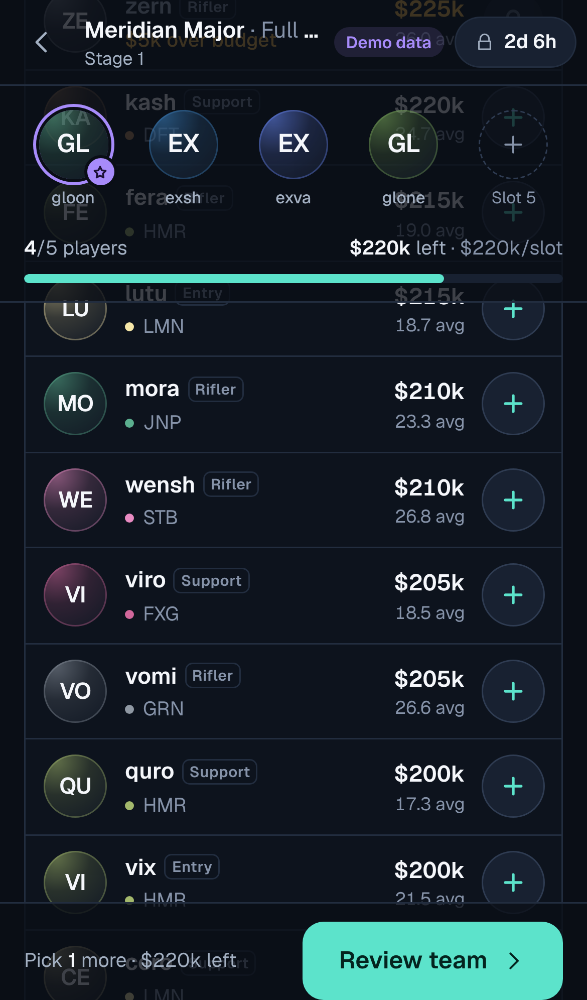
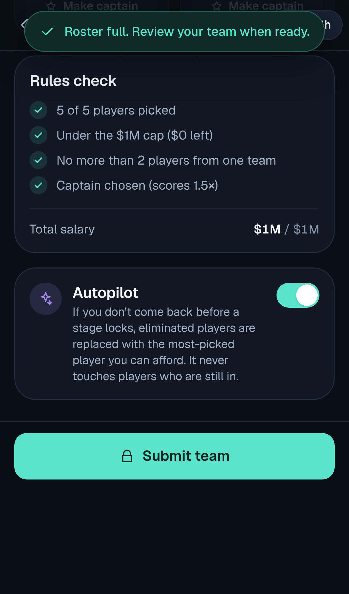
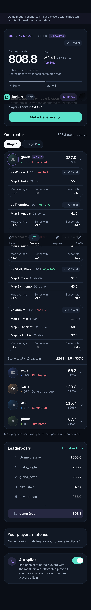
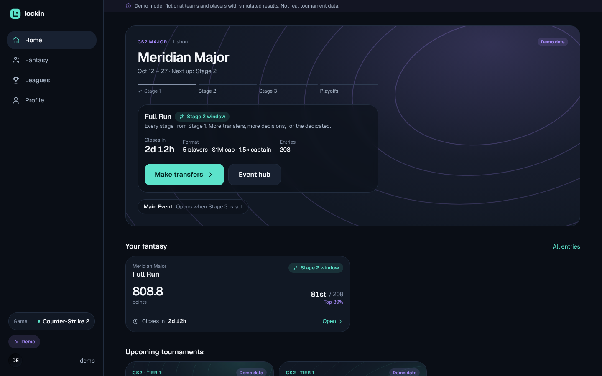

# Lockin: CS2 tournament fantasy

**Lockin** is a temporary working name. Build a five-player Counter-Strike 2 fantasy team for a real tournament, follow it map by map, make transfers between stages, and compete globally and in private leagues with one entry.

This branch (`esports-fantasy`) is an independent project. It shares no code, history, data or credentials with Sky or any other project in this repository.

> **Demo data:** no licensed esports data feed is connected yet. The app runs on a clearly labelled demonstration provider: fictional teams, fictional players and simulated matches, pushed through the real ingestion, scoring and contest pipeline. Nothing in the demo is real tournament information.

| Phone | | |
|---|---|---|
|  |  |  |



## What works

- **Home:** featured event, your active teams, upcoming events, recent results.
- **Tournament hub:** overview, the two Major contests (Main Event and Full Run) explained, rules rendered from the pinned rule set, matches, bracket and Swiss standings.
- **Lineup builder:** search, team/role/budget filters, five sort orders, inline reasons why a player can't be added (cap, team limit, dead-end budget), a player detail sheet, "Suggest", a draft saved on the device, offline handling, and a three-column desktop layout.
- **Roster review:** a team-announcement layout, a rules checklist, captain choice, the Autopilot switch, and server-validated submission with a confirmation and sharing.
- **Live dashboard:** points, rank, movement, percentile, and per-player status (playing now, next match, eliminated, did not play). A per-map breakdown traces every point to the scoring ledger. It also shows score states (provisional, official, settled, corrected), Autopilot activity and the transfer window.
- **Transfers:** two per stage window; replacing eliminated players is free; kept players stay at the price you paid.
- **Leaderboards:** global, friends (people you share a league with), and every league you're in, from the same entry. Paged, with your row pinned.
- **Private and public leagues:** invite links, an invite preview, joining with your existing entry, owner controls.
- **Profiles:** permanent history of settled results, best finish, percentiles, titles.
- **Accounts:** sign up and sign in, with scrypt password hashing and hashed session tokens.

## Run it

Requirements: Node 22+. PostgreSQL 16 is recommended; without `DATABASE_URL` the app uses embedded PGlite in `.data/` instead.

```bash
npm install
cp .env.example .env          # set DATABASE_URL (or remove it to use PGlite)
npm run db:reset              # create schema (drizzle migrations)
npm run db:seed               # demo world: a completed event, then the featured Major opens (~30 s)
npm run dev                   # http://localhost:3000
```

- **Demo account:** `demo` / `lockin-demo`.
- **Demo controls:** the **Demo** button (top bar on phones, sidebar on desktop) moves the server's demo clock to the end of the next stage. Lineups lock, Autopilot runs, results are ingested and scored, and the next transfer window opens. A whole Major plays out in a few clicks.

## Test it

```bash
npm run check                 # typecheck + lint + unit/integration tests (vitest)
npm run test:e2e              # production build + Playwright: 22-step journey (phone), axe accessibility, desktop builder
```

- **Unit tests:** every worked example in `docs/04-gameplay-and-scoring.md` reproduces exactly. Fairness checks (BO1/BO3/BO5 parity, 3-0 vs 3-2, team-result share) run on simulated Majors, plus roster rules, transfers, tiebreaks and Autopilot.
- **Integration test:** the full gameplay journey runs through the real services on an in-memory PostgreSQL. It covers locks, a stats correction without double counting, free replacements, the transfer limit, Autopilot with an audit trail, and settlement through to the profile.
- **Browser tests:** all 22 acceptance steps on an iPhone-sized viewport, accessibility (WCAG 2.1 AA, no serious violations) on key screens at both sizes, and the desktop layout.

## How it's built

```
src/domain/         pure rules: roster validation, transfers, CS2 scoring (versioned rule sets),
                    advancement credit, stage scoring, entry scoring, tiebreaks, Autopilot
src/server/
  providers/        adapter boundary (normalised model) · demo provider · PandaScore stub
  ingest/           sync (validate, version, corrections) · ledger scoring · pricing ·
                    contest lifecycle (windows, locks, Autopilot, settlement) · standings
  services/         entries, leagues, leaderboards, demo
  queries/          read models for each screen
  auth/  db/        sessions + scrypt · Drizzle schema (PostgreSQL / PGlite) + migrations
src/app/            Next.js App Router pages and API routes
src/components/     design system (ui/), builder, entry dashboard, tournament, leagues
tests/              unit · integration · e2e (Playwright)
```

- **Stack:** Next.js 15 (App Router), React 19, TypeScript (strict), Tailwind CSS 4, Drizzle ORM, PostgreSQL, motion, vaul, Vitest, Playwright.
- **Scoring is deterministic and auditable.** An append-only ledger (`scoring_events`) is idempotent by input hash; corrections supersede rows and never overwrite them; every contest pins a rule-set version so any result can be replayed.
- **All gameplay rules are enforced on the server.** The client runs the same rule functions for instant feedback only.

## Documents

Research and product blueprint: [`docs/`](docs/README.md). What changed during the build and why: [`docs/10-implementation-decisions.md`](docs/10-implementation-decisions.md).
