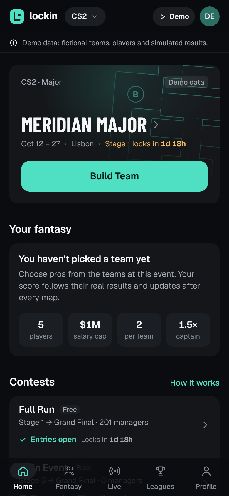
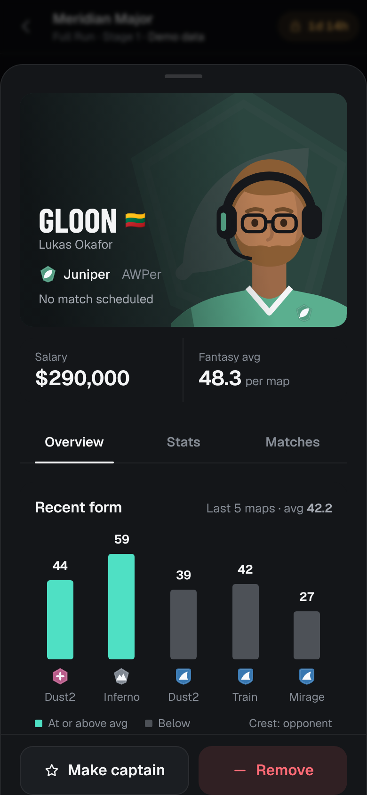

# Lockin: CS2 tournament fantasy

**Lockin** is a temporary working name. Build a five-player Counter-Strike 2 fantasy team for a tournament, follow it live, make transfers between stages, and compete globally and in private leagues with one entry.

This branch (`esports-fantasy`) is an independent project. It shares no code, history, data or credentials with Sky or any other project in this repository.

> **Demo data:** no licensed esports data feed is connected yet. The app runs on a clearly labelled demonstration provider: fictional teams, fictional players and simulated matches, pushed through the real ingestion, scoring and contest pipeline. Nothing in the demo is real tournament information.

Start here: [rules](docs/GAMEPLAY.md) · [design](docs/DESIGN.md) · [live data](docs/LIVE_DATA.md) · [architecture](docs/ARCHITECTURE.md) · [plan and status](docs/IMPLEMENTATION_PLAN.md) · [scoring fairness](docs/SCORING_FAIRNESS.md).

| Home | Build Team | Player | Roster review | My Fantasy |
|---|---|---|---|---|
|  |  |  |  |  |


## What works

- **Navigation:** Home · Fantasy · Live · Leagues · Profile. CS2 is active; LoL and VALORANT are shown as coming later.
- **Home:** changes with your state: one hero action (Build Team, Edit Team, Make Transfers, Join Late, View My Team, View Standings), a live card when your players are playing, your active teams, upcoming events and recent results.
- **Tournament hub:** overview, the two Major contests (Main Event and Full Run) explained, rules rendered from the pinned rule set, matches, bracket and Swiss standings.
- **Lineup builder:** a sticky salary summary with five neutral slots, search, quick filters (team, sort, fits budget; roles in a sheet), salary/fantasy-average/form sorts, inline reasons why a player can't be added (cap, team limit, dead-end budget), a player sheet that keeps your place, "Suggest", a draft saved on the device, offline handling, and a three-column desktop layout (filters 240 · pool · lineup 360).
- **Roster review:** the lineup as a poster (captain in the centre, two either side; tap to change captain), salary used and remaining, the rules checklist, the Autopilot switch, and server-validated submission with a confirmation.
- **Live GameDay (`/live`):** updates by Server-Sent Events without refreshing. It shows your total, rank and league ranks; players grouped as playing now, up next, and finished or out, with live map score, K–D–A and provisional map points; Rival Watch (the managers just above and below you, the gap, shared and different players); and an activity feed built only from ledger rows and rank changes. Connection, delayed and stale states are always shown.
- **Match Center:** per-map scoreboards with fantasy map points under your contest's rules. Your players are marked. It never invents round-by-round events.
- **My team:** points, rank, movement and per-player status. A per-map breakdown traces every point to the scoring ledger, with score states (provisional, official, settled, corrected), Autopilot activity and the transfer window.
- **Tournament progression:** Swiss stages, then quarterfinal, semifinal and Grand Final windows. Eliminated players are replaced free. You get 2 strategic transfers per Swiss window and 1 per playoff window, and up to 3 players from one team in the final. Kept players stay at the price you paid. Autopilot is optional, deterministic and audited ([rules](docs/GAMEPLAY.md)).
- **Results:** a recap with placement, percentile, Fantasy MVP, captain bonus, best value pick, earned awards and league placements, plus a share image that hides names until lock.
- **Leaderboards:** global, friends (people you share a league with), every league you're in, and a cup for each stage, all from the same entry. Paged, with your row pinned.
- **Private and public leagues:** invite links, an invite preview, joining with your existing entry, owner controls.
- **Profiles:** permanent history of settled results, best finish, percentiles, titles.
- **Accounts:** sign up and sign in, with scrypt password hashing and hashed session tokens.

## Run it

Requirements: Node 22+. PostgreSQL 16 is recommended; without `DATABASE_URL` the app uses embedded PGlite in `.data/` instead.

```bash
npm install
cp .env.example .env          # set DATABASE_URL (or remove it to use PGlite)
npm run db:reset              # create schema (drizzle migrations)
npm run db:seed               # demo world: a completed event, then the featured Major opens (~30 s)
npm run dev                   # http://localhost:3000
```

- **Demo account:** `demo` / `lockin-demo`.
- **Demo controls:** the **Demo** button (top bar on phones, sidebar on desktop).
  - **Watch live** jumps to the next match and replays it at 20× through the real pipeline; open Live to follow it.
  - **Skip ahead** moves the demo clock to the end of the next stage: lineups lock, Autopilot runs, results are scored and the next transfer window opens.
  - **Back to real time** stops the replay.

## Test it

```bash
npm run check                 # typecheck + lint + unit/integration tests (vitest)
npm run test:e2e              # production build + Playwright: 22-step journey (phone), axe accessibility, desktop builder
```

- **Unit tests:** every worked example in `docs/04-gameplay-and-scoring.md` reproduces exactly. Fairness checks (BO1/BO3/BO5 parity, 3-0 vs 3-2, team-result share) run on simulated Majors, plus roster rules, transfers, tiebreaks and Autopilot.
- **Integration test:** the full gameplay journey runs through the real services on an in-memory PostgreSQL. It covers locks, a stats correction without double counting, free replacements, the transfer limit, Autopilot with an audit trail, and settlement through to the profile.
- **Browser tests:** all 22 acceptance steps on an iPhone-sized viewport, accessibility (WCAG 2.1 AA, no serious violations) on key screens at both sizes, and the desktop layout.

## How it's built

```
src/domain/         pure rules: roster validation, transfers, CS2 scoring (versioned rule sets),
                    advancement credit, stage scoring, entry scoring, tiebreaks, Autopilot
src/server/
  providers/        adapter boundary (normalised model) · demo provider · PandaScore stub
  ingest/           sync (validate, version, corrections) · ledger scoring · pricing ·
                    contest lifecycle (windows, locks, Autopilot, settlement) · standings
  services/         entries, leagues, leaderboards, demo
  queries/          read models for each screen
  auth/  db/        sessions + scrypt · Drizzle schema (PostgreSQL / PGlite) + migrations
src/app/            Next.js App Router pages and API routes
src/components/     design system (ui/), builder, entry dashboard, tournament, leagues
tests/              unit · integration · e2e (Playwright)
```

- **Stack:** Next.js 15 (App Router), React 19, TypeScript (strict), Tailwind CSS 4, Drizzle ORM, PostgreSQL, motion, vaul, Vitest, Playwright.
- **Scoring is deterministic and auditable.** An append-only ledger (`scoring_events`) is idempotent by input hash; corrections supersede rows and never overwrite them; every contest pins a rule-set version so any result can be replayed.
- **All gameplay rules are enforced on the server.** The client runs the same rule functions for instant feedback only.

## Documents

Each kind of decision has one authoritative document. If two documents disagree, the one listed here wins.

| Decision | Authoritative document |
|---|---|
| Game rules: windows, transfers, captain, Autopilot, ranking, score states | [`docs/GAMEPLAY.md`](docs/GAMEPLAY.md) |
| Rules still being decided | [`docs/GAMEPLAY_OPEN_QUESTIONS.md`](docs/GAMEPLAY_OPEN_QUESTIONS.md) |
| Scoring formula (points per event) | [`docs/04-gameplay-and-scoring.md`](docs/04-gameplay-and-scoring.md), rule set `cs2-v2` |
| Evidence that scoring is fair | [`docs/SCORING_FAIRNESS.md`](docs/SCORING_FAIRNESS.md) (generated) |
| Visual and interaction design | [`docs/DESIGN.md`](docs/DESIGN.md) |
| Data providers, usage rights, live behaviour | [`docs/LIVE_DATA.md`](docs/LIVE_DATA.md) |
| Application architecture, ledger, realtime, security | [`docs/ARCHITECTURE.md`](docs/ARCHITECTURE.md) |
| Milestones and status | [`docs/IMPLEMENTATION_PLAN.md`](docs/IMPLEMENTATION_PLAN.md) |
| Why the build departed from the research | [`docs/10-implementation-decisions.md`](docs/10-implementation-decisions.md) |

The research and product blueprint (docs 01–09) is kept unchanged as the record of how these decisions were reached: [`docs/`](docs/README.md).
