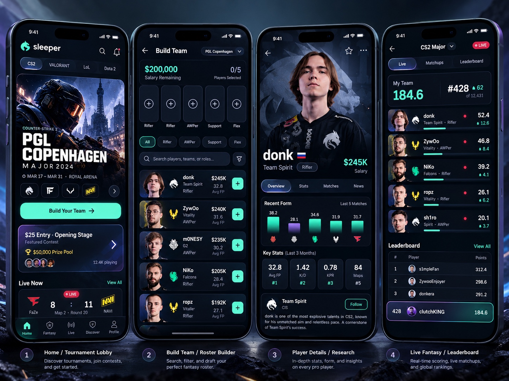

# Esports Fantasy — Product Design System & UX Specification

**Status:** Working design source of truth · **Version:** 1.6 (see [changelog](#changelog)) · **Primary platform:** Mobile web / iPhone first · **Launch esport:** CS2

> **North star:** *Sleeper esports personality, refined with the restraint, clarity, and precision of a top-tier iOS app.* Player-first. Competition-first. Calm surfaces, vivid content, exquisite interaction details. The app must feel intentionally designed rather than generated from a generic dashboard template.

**Reference-image policy:** The image above is an **internal mood/layout reference**, not a production asset, pixel-perfect target, or source of facts. It contains Sleeper branding and illustrative statistics, tournament details, affiliations, fees, and leaderboard data. **Do not reproduce Sleeper's name, logo, artwork, trade dress, or proprietary assets. Do not ship the image.** Create an original product identity. Use only properly licensed esports images/logos; otherwise use clean placeholders. Never treat numbers or labels in the image as verified product data.

---

## 1. What we are building

A tournament-based esports fantasy product: fans pick **five professional CS2 players** under a configurable salary cap, submit one lineup for a tournament contest, follow their performance as official map results arrive, and compete on **global, friends, private, and eventually creator** leaderboards. A single eligible entry can appear across multiple leaderboards. Between-stage transfers may be available under contest rules. The app launches with CS2 and should be extendable to LoL and VALORANT without redesigning the core UX.

**User experience in one sentence:** Discover event → inspect players → assemble lineup → review / submit → follow fantasy score → compare standings → make allowed stage changes → return for next event.

**Initial app surfaces:** Home / Tournaments, Fantasy, Leagues, Profile, plus contextual Tournament Overview, Build Team, Player Details, Roster Review, Fantasy Live/Updates, and Leaderboard. Pick'Ems and traditional draft leagues are **not part of the initial navigation or MVP**.

**Gameplay source of truth:** `docs/04-gameplay-and-scoring.md` and `docs/09-prd.md`. UI must **never invent** roles, salary caps, captain multipliers, transfers, prize pools, positional requirements, team limits, scoring cadence, or contest statuses; display configured rules and actual data. Default planning example only: $1M cap, 5 players, maximum 2 per professional team, captain 1.5×, and controlled transfers between stages. All must be confirmed from actual contest configuration.

**MVP is free-to-play.** No invented cash-entry fees, prize pools, or betting-related imagery. The reference's paid contest treatment should become a **free fantasy contest card** or a verified real sponsor reward only if legitimate and authorized.

---

## 2. What to keep / what to fix in the reference

### Preserve

1. **Four expressive product moments:** tournament discovery; roster-builder; immersive player research; fantasy standings.
2. **Player portraits as focal points**, supported by team identification and useful numbers.
3. **Deep navy atmosphere**, compact mobile navigation, restrained mint accent and secondary purple accents.
4. **Highly recognizable esports content:** major events, teams, matchups, fantasy managers, rank movement.
5. **Fast utility:** select a player from one row; inspect stats without losing draft context.

### Refine aggressively

1. **Reduce simultaneous visual noise.** No competing glow on every card, border, tab, chart, chip, and button. A single strongest focal point per screen.
2. **Make a typographic hierarchy, not a wall of labels.** More room around headings/values; avoid 9–10px body text; use tertiary text sparingly.
3. **Replace template-like card repetition.** Vary composition by function: a cinematic tournament hero, a dense functional player row, an editorial player profile, a numerical scoreboard.
4. **Give every pixel a purpose.** Establish consistent margins, radii, spacing, icon sizes, and baseline alignment.
5. **Keep real CS2 semantics.** Do not force five distinct positions called Rifler/AWPer/Support/Flex unless that is an explicit scored contest format. If no positions are required, show five neutral roster slots, optionally player role metadata.
6. **Use authentic, licensed assets.** Consistent crops and quality. Do not generate fake professional player likenesses or mismatched team affiliations.
7. **Remove unsupported facts:** historical tournament marketing dates presented as future, imaginary live scores, unlicensed prizes, and unverified performance claims.
8. **Improve the mobile viewport.** Headers, hero, bottom navigation and a keyboard-safe fixed review bar must coexist without requiring awkward scroll gymnastics.
9. **Own the identity.** No Sleeper branding, no Huddle branding, no pasted competitor layout. Create a distinct brand mark, app name, image treatment, and interaction language.

**Editorial taste rule:** 80% calm utility and 20% esports energy. When in doubt, remove a visual effect rather than add one.

---

## 3. Visual foundation

### 3.1 Design tokens

These are **starting tokens**. Adjust only as part of a deliberate, documented system; do not locally invent near-duplicate colors on individual screens.

| Purpose | Token | Value | Guidance |
|---|---|---|---|
| Canvas | `--bg` | `#0B0C0F` | Near-neutral dark with a trace of blue; never navy, never pure black |
| Base surface | `--surface-1` | `#141619` | Cards, list containers |
| Raised surface | `--surface-2` | `#1B1E22` | Selected rows, sheet headers, inputs |
| Subtle surface | `--surface-3` | `#24282D` | Hover, empty slots, portrait tiles |
| Hairline | `--border` | `rgba(255,255,255,0.07)` | Row dividers only. Containers have **no** border |
| Primary text | `--text-1` | `#F4F5F6` | Titles, scores, names; also the "selected/captain" ink |
| Secondary text | `--text-2` | `#A5AAB2` | Supporting copy |
| Tertiary text | `--text-3` | `#868C95` | Metadata (≥ 4.5:1 on every surface) |
| Accent | `--mint` | `#4FE0C4` | **Only** primary actions, live/active state, positive deltas, focus |
| Mint wash | `--mint-wash` | `rgba(79,224,196,0.12)` | The "you" row, open-window banner |
| Negative/error | `--danger` | `#FF6B76` | Invalid, eliminated, losses |
| Pending/warning | `--amber` | `#F5B85C` | Lock countdowns, action required, provisional |
| Live | `--live` | `#FF4D5E` | The live dot only |

**v1.2:** the violet second accent is retired. Captain, selected chips and rank emphasis invert to ink (white fill, dark text) instead. Colour comes from content: team colours on portrait tiles, jerseys and crests.

Use CSS variables / a Tailwind theme. Never hardcode different near-equivalent mint, navy, or purple shades across components.

### 3.2 Type system

Use **Inter**, **Geist**, or a similar carefully rendered, highly legible modern sans-serif. Use **tabular numerals** for fantasy points, salary, rank, countdown, standings.

| Role | Mobile size / line-height | Weight |
|---|---|---|
| Screen hero headline | 28 / 34 | 650–700 |
| Page title | 24 / 30 | 650–700 |
| Section title | 18 / 24 | 600–650 |
| Standard card title | 16 / 22 | 600 |
| Primary body / player name | 14–15 / 20–22 | 450–600 |
| Secondary data / helper | 13 / 18 | 400–500 |
| Small label / badge | 12 / 16 | 500–600 |
| Big score | 30–36 / 38 | 700, tabular |

**Display face (v1.2).** A condensed sports face (Barlow Condensed 600–700, uppercase) is used for exactly three things: event titles, a player's name in a hero or the lineup showcase, and big numbers (fantasy points, rank). Everything else is Geist. A binary weight hierarchy in UI text: 600–700 for what you act on, 400 for everything else.

**Avoid text below 12px.** Important player salaries and fantasy metrics should be at least 14px. Do not use narrow, condensed display fonts for ordinary content. Protect names and values from truncation; only truncate metadata where acceptable.

### 3.3 Geometry and spacing

- Base spacing scale: `4, 8, 12, 16, 20, 24, 32, 40` px.
- Screen horizontal inset: **16px** on small phones, **20px** on larger phones.
- Standard vertical section spacing: **24px**; related card row spacing: **8–12px**.
- Standard interactive control height: **44–48px**; primary CTA: **50–54px**.
- Compact rows: **68–80px**, never a 40px press target.
- Radius by role (v1.6): **3–5px** tags and inner segments, **6–8px** buttons and inputs, **8–10px** cards, portrait tiles and the hero container; full circles only for avatars and status dots.
- Containers have no border (v1.2): separate by a surface step or by space. 1px hairlines only between rows. Shadow only on things that float (sheets, toasts, the sticky "you" row).
- Navigation bar: approximately **64–72px content height** + bottom safe area.
- iOS safe areas: `env(safe-area-inset-top)` and `env(safe-area-inset-bottom)` where applicable.
- Desktop content max-width: **1360px** with intentional gutters; do not stretch data panels indefinitely.

### 3.4 Lighting, backgrounds and image treatment

- No full-page gradients by default. Use flat charcoal/navy surfaces and image-driven depth.
- One restrained spotlight behind **hero imagery** or selected player, not everywhere.
- Player portraits (v1.2): demo players are fictional, so they get flat illustrated busts (varied skin tone, hair, accessories) wearing the team's colours on a flat team-tinted tile. Real players get licensed headshots in the same frame; an illustration never stands in for a real person.
- Team colors: portrait tiles, jerseys, crests and the crest watermark in a player hero. Never the app's UI accent.
- Prefer actual licensed event imagery or an original abstract event graphic. Do not use random Counter-Strike screenshots as universal art.
- Event art (v1.3): until licensed key art exists, the event's own name is the artwork: outlined display type repeated in three steps of strength, tilted a few degrees, bleeding off the right edge behind one spotlight in the tier colour, masked away from the headline. It is hidden on narrow tournament banners where it would collide with text.
- Gradients only when they clarify hierarchy (e.g., bottom fade for headline over a hero image).
- No excessive blurs, fluorescent borders, fake glassmorphism, heavy beveled cards, or mysterious icons.

### 3.5 Iconography and copy

- One icon family throughout (Lucide or equivalent), consistent 1.75–2px strokes, usually **18–22px**.
- Clear direct labels: **Build Team**, **View My Team**, **View Standings**, **Review Lineup**, **Submit Lineup**.
- Use competition states exactly: **Open**, **Locks in 2h**, **Map in progress**, **Scores update after each map**, **Final**, **Transfers open**.
- No fake “LIVE” badge for fantasy points that only refresh after each completed map. A match can be live while the fantasy score remains pending.
- States are coloured text with an icon or dot, not pills (v1.2). At most one small badge style (4px radius) for tags such as Demo data. Labels above titles are sentence case; the one exception is match metadata, set as monospace caps (`.kicker`, v1.6).
- Currency styling: use compact `$245K` on player rows, but full `$245,000` on details; maintain one semantic salary unit.

---

## 4. Core mobile shell

**Navigation model (v1.1):** Home · Fantasy · **Live** · Leagues · Profile (5 tabs). Live is a top-level destination because following your players during matches is the core loop, not a sub-page of an entry. A persistent bottom bar on top-level screens, contextual header/back navigation in deeper routes. Avoid a second bottom bar inside the fantasy builder.

**Header:** 52–60px. Left logo or back arrow; centered or leading current page context, not both competing; right actions limited to one or two. Tournament and sport switches must have obvious interactive states.

**Scrolling:** Header may be sticky when beneficial; bottom nav fixed. Avoid multiple independently scrolling panels on mobile. If the review CTA is sticky, account for the keyboard and safe area so it never obscures the list.

**Transitions:** Deep links directly into tournament and league pages must work; return to builder restores search query, filters, selected players, and scroll position.

---

## 5. Screen specifications

### 5.1 Home — tournament lobby

**Job:** Find a tournament and resume an active fantasy competition in under 5 seconds.

**Visual hierarchy:**

1. Compact branded top bar + esport selector (CS2 active; future esports disabled or labeled *Coming later*).
2. **One featured tournament hero**: original/esports-licensed visual, event name, relevant dates and stage, open/locked status, a single clear **Build Team** CTA.
3. **Your Fantasy**: entry card with rank, points, progress, and next action. If no entry, thoughtful create-team prompt.
4. Smaller **Upcoming Events** cards below.
5. Recent relevant match results only when useful; not a parallel full scores app.

**Hero sizing:** At 390px viewport width, start around **210–250px** tall including body/CTA; avoid a 400px banner that hides all secondary content. Use art plus readable bottom overlay (not text baked into art). Have alternate treatments for artwork-unavailable states.

**Do not reproduce screenshot:** No oversized cash entry/prize card on the home screen for a free-to-play MVP. No generic glittery tournament art collage. One mint CTA, not three fighting for attention.

### 5.2 Tournament overview

**Job:** Understand competition structure, available fantasy contests, lock times, participating teams, and bracket/status.

- Clear hero: event identity, stage, dates, legitimate status, succinct explanation of fantasy rules.
- Tabs: **Overview · Fantasy · Matches · Bracket · Standings**; collapse/scroll if necessary, do not squeeze into unreadable labels.
- Main Event and Full Run only if approved and configured; show what stage counts, when lock occurs, and who is eligible.
- Progression timeline: stage chips with *current / upcoming / complete* markers.
- One highlighted next action; no duplicate buttons above and below the same content without cause.
- Brackets: independently scrollable in their own detail view, not crammed into tiny cards.

### 5.3 Build Team — flagship functional screen

**Job:** Build a valid five-player fantasy lineup quickly without sacrificing useful research.

**Sticky first section / compact:** Back arrow + tournament label + honest lock countdown; salary summary; 5 neutral roster slots with thumbnail / nickname when selected. Expanded lineup is a separate tap, not permanently huge.

**Middle:** Search input; quick controls for **All**, team, and appropriate player metadata; sorting **Salary**, **Fantasy Average**, **Recent Form** (only where sourced). A compact filter button opens a sheet for advanced filters. Avoid role tabs *Rifler / AWPer / Support / Flex* if those are not formal eligibility constraints.

**Player pool row (target 72px):**

- 46–52px consistent portrait region.
- Nickname in 15px semibold; team + role in secondary 12–13px.
- Right column: `$245K` in 14px semibold; derived historical fantasy average in 13px.
- A 44px add/remove icon button with unmistakable states.
- Tapping name/portrait opens player detail bottom sheet; tapping plus selects immediately.
- Show selection state without painting the entire row mint. Use subtle tinted strip/border and selected icon.
- Max team count / cap errors should explain **why** the add is unavailable.

**Math/feedback:** Salary bar is clear but subordinate to salary value; amount updates instantly. Validations must be server-authoritative upon submission. If a selected player becomes ineligible, keep the draft and flag the issue rather than silently removing a player.

**Bottom sticky primary action:** **Review Team** when full and valid; otherwise `3 of 5 players selected` with a disabled action, or another honest useful state. Keyboard must not cover this control.

**Performance goal:** Search/filter and add/remove should feel immediate; no full-screen loading between selections. Preserve draft on navigation / temporary offline interruption.

**Empty/invalid cases:** No search matches, insufficient salary, max team members reached, player removed from contest, locked contest. Each includes an action or explanation.

### 5.4 Player detail — immersive editorial research

**Job:** Know who the player is and decide whether they are worth the fantasy salary.

- Hero can occupy upper **30–38%** of screen with a prominent licensed portrait against a restrained team-branded background.
- Back icon, optional watchlist/favorite, no excessive toolbar controls.
- Nickname + nationality + team + role; price and average points should be high priority; actual status shown clearly.
- Tab bar: **Overview · Stats · Matches**. Don't add *News* until actual news integration exists.
- Overview: 5-match fantasy-point spark/bar chart with honest sample sizes; 3–4 meaningful stat tiles; upcoming opponents; one paragraph only if verified / authored from facts.
- Fixed **Add to Team** action when viewing from the roster builder, respecting all rules; in informational context use non-deceptive action/state.
- On mobile, allow a non-navigation bottom sheet for quick research; a full player route for deeper investigation. Share components/state across both.

**No fake numbers:** Player/team affiliations are time-dependent, as are team photos and event rosters. Data must come from contest-specific eligibility and mapped identities.

### 5.5 Roster review — signature visual share moment

**Job:** Make completing a lineup feel rewarding and trustworthy.

- Five-player showcase arranged intentionally (e.g., prominent captain center + balanced 2/2, OR a clean five-card carousel for narrow screens). **Do not force a collage that makes names unreadable.**
- Portraits dominate; coherent image backgrounds and crisp typography.
- Show player nickname, team, salary; distinguish Captain `×1.5` only if enabled in the contest.
- Below showcase: used budget, remaining salary, eligible team count, lock time, any validation issues.
- **Submit Team** primary action; final server validation; success confirmation.
- Social share card uses an original, consistent brand identity, with fallbacks if photos cannot be used.
- Format review portrait-first; mobile functional builder remains compact.

### 5.6 My Fantasy — match tracking / fantasy scoring

**Job:** Understand points, rank, active players, and what will update next.

- Top summary: Fantasy Points (large), Global Rank (large), movement, stage, last data update.
- Five player rows: photo, name, team, match state, fantasy points, last-map change. Visually distinguish **in-progress match** from **points finalized**.
- Tap player for point breakdown; scoring calculations come from an auditable backend.
- Show map-result status honestly: `Map 2 in progress · Fantasy points update when map ends` when appropriate.
- *v1.1:* once the tournament ends, the summary hero is replaced by the **Results recap** (§5.11), and the five player rows remain beneath it.
- Below: compact leaderboard preview, stage progression, permitted roster action.
- Do not turn this into a comprehensive match broadcast interface.

### 5.7 Leaderboards

**Job:** See relative standing and compare lineups.

- Segmented control: Global / Friends / Private (where available).
- Dense but readable rows (60–64px): rank, avatar, username, points, movement.
- Current user accent row; if scrolled out of view, one sticky summary at bottom that doesn't duplicate when the row is visible.
- Private league invite/create entry point when relevant.
- Competing entries must be shown only after the contest's roster-visibility rules permit it.
- Avoid giant nested cards around an ordinary ranking table; improve row rhythm and alignment instead.

### 5.8 Profile and leagues

- Profile hero: avatar, username, preferred esport; simple verified stats, event history, placements, achievements earned.
- No fictional trophies or ranking data in production.
- Leagues: create/join with minimal fields; reusable invite link; eligible existing contest entry appears in relevant standings without duplication.

### 5.9 Live GameDay (v1.1)

**Job:** During matches, answer "how am I doing right now, and what happens next?" without refreshing.

- **Header:** tournament, current stage, and a connection chip: `Live` / `Connecting` / `Reconnecting` / `Data delayed` / `Offline`, plus "Updated Ns ago". The chip is text plus a dot, never colour alone.
- **Score card (the focal point):** fantasy points in `text-score`, global rank with movement, and league ranks as chips. When the total changes, the number does a 600ms flash; reduced motion skips it.
- **Stale notice:** if no new snapshot or sync has arrived within the thresholds in LIVE_DATA.md, an amber notice sits directly above the scores, giving the time of the last update. Numbers stay visible.
- **Player groups:** `Playing now`, then `Up next` (opponent and local start time), then `Finished or out`. A playing row shows:
  - the map and score;
  - K–D–A;
  - **live map points** labelled `map pts · live`, visually secondary to the total.

  Live map points are never added to the total (GAMEPLAY.md G-1).
- **Rival Watch:** the managers directly above and below you, with the gap in points, shared players, and their players you don't have. A "playing" tag appears only when that player's match is live. The copy is a plain fact ("You trail by 3.4"); no probabilities.
- **Your matches:** the live and next matches involving your players, linking to the Match Center.
- **Activity:** every item comes from a ledger row or a standings snapshot (map scored, series won, advancement credit, correction, rank change). No generated chatter.
- **Empty states:** signed out → sign in; no entry → find a tournament; nothing live → the next match time for your players.

### 5.10 Match Center (v1.1)

- Score header with both teams, the format (BO1/3/5), the status, and the map tabs.
- For each map: a scoreboard per team showing player, K–D–A and **fantasy map points under the viewer's contest rules** (other provider stats appear only once a licensed feed is confirmed to supply them). Your players get a mint-wash row and the word "yours", so ownership never relies on colour alone.
- A provider-honesty line sits under the scoreboard. On a live map it says the fantasy column is provisional, joins the total when the map ends, and that the provider supplies scoreboards, not round-by-round play. The page never invents round history.

### 5.11 Results recap and share card (v1.1)

- **Recap** (entry page after the final): placement "Nth of N" in `text-title`, points and percentile, award chips (Champion, Top 1/10/25%, League winner; only when earned), then three facts: Fantasy MVP, captain bonus (and best possible captain), and best value (points per $100K). League placements follow, then **Share** and **Next tournament**.
- **Share card** (`/api/og/entry/[id]`, 1200×630): brand mark, tournament, points and rank, and five silhouette portraits with crests.
  - Before a window locks, player names are replaced by "Hidden until lock", so sharing early never leaks a lineup.
  - "Demo data" is printed on demo tournaments.
- Shared links unfurl with this card (Open Graph and Twitter metadata on `/e/[id]`).

### 5.12 Transfer management (v1.1)

- Transfers happen in the builder, opened from **Make Transfers** (Home hero, entry page, Live). The header names the window ("Quarterfinals transfers") with the lock countdown. A transfer notice above the list reads `N of N transfers used · Replacing eliminated players is free` and lists eliminated players as one-tap removal chips.
- Eliminated players show as **Out** in their slot. Replacing one never shows a transfer count change.
- Kept players display the price paid; new signings show the current price. The salary summary uses the same numbers the server validates.
- When a window raises the team limit (the Grand Final), the builder says so in words: "Up to 3 players from one team in the Grand Final".
- Autopilot status and what it did are listed on the entry page, tagged `Autopilot`.

### 5.13 Stage cups (v1.1)

- A leaderboard scope per window (`Stage 3 Cup`, `Quarterfinals Cup`…) ranked by points scored in that stage only. It gives late joiners and managers with a slow start something to win. The scope control scrolls horizontally on mobile; it never wraps to two lines.

---

## 6. Desktop adaptation

At widths above roughly **1024px**, stop stretching the mobile pattern. Use a deliberate desktop composition:

- Top navigation / compact left nav; content max-width ~1360px.
- Tournament page: hero + contest details + upcoming matches in clean columns.
- **Builder:** left filter rail **240px**; central player pool flexible; right sticky roster **340–380px**. All three remain visible on standard desktop viewports.
- Player detail: portrait hero left, relevant statistics right, deeper history below.
- Live fantasy: score and roster left/main; leaderboard, stage details, matches right.
- Keep visual tokens identical across breakpoints; only information arrangement changes.

Breakpoints are starting points, not dogma: verify at **375, 390, 430, 768, 1024, 1440** CSS pixels. Test browser zoom and iOS safe area.

---

## 7. Animation & tactile behavior

**Motion budget:** Most state changes **140–220ms**, major sheet transitions **220–300ms**. Prefer opacity/transform; do not animate layout-heavy properties at every score update. Respect `prefers-reduced-motion`.

| Interaction | Desired behavior |
|---|---|
| Add player | Immediate button state change, roster slot fills, salary interpolates subtly (or updates directly under reduced motion) |
| Remove player | Instant release with short reverse transition; related disabled choices re-enable |
| Open player detail | Bottom sheet rises smoothly; close restores exact builder scroll/filter state |
| Select captain | Clean selection outline / badge; remove badge from previous captain |
| Submit lineup | Explicit review and validation; success state only after server confirms |
| Map finalized | Point changes highlight briefly once; updated timestamp shown |
| Rank changes | Modest arrow + numeric change, no confetti or blinking scoreboard |
| Error | Local inline explanation, no generic modal for routine validation |

Use haptics only in supported native/mobile contexts, sparingly. No sound effects by default.

---

## 8. Content authenticity and data honesty

This is as important as visual polish.

- **No fictional live data** in production screens. Development/demo state must be visibly labeled.
- The provided mockup includes **Sleeper's logo**, an outdated/historical event label, hypothetical player photos, fake stat values, role labels, prizes and live scoreboards. Treat every one as *style direction only*.
- Confirm current roster/team affiliation for each tournament; use contest snapshot identities.
- Do not suggest live fantasy event scoring if the product updates after **completed maps** only. *v1.1:* in-map points are shown per player as `map pts · live` and are never presented as part of the total.
- Never show an apparently live screen on stale data: connection and freshness states are always visible on Live and the Match Center (§5.9).
- Don't show fabricated projections unless they are modeled and labeled.
- Use image rights cleared for commercial use; preserve fallback quality when team logos, event images, or headshots are unavailable.
- Reflect user score as **provisional** until finalized if provider corrections are possible.
- Avoid premium or money-entry promises not supported by actual product/legal decisions.

---

## 9. Components and architecture expectations

Required visual primitives:

`AppShell`, `TopBar`, `BottomNav`, `SportSwitcher`, `TournamentHero`, `EventStatus`, `FantasyEntrySummary`, `StageStepper`, `PlayerRow`, `PlayerPortrait`, `TeamMark`, `SalaryDisplay`, `RosterSummary`, `RosterSlot`, `RosterShowcase`, `CaptainBadge`, `FilterChip`, `PlayerSearch`, `PlayerDetailsSheet`, `PlayerStatsChart`, `FantasyScore`, `LiveMapStatus`, `LeaderboardRow`, `StickyMyRank`, `LeagueCard`, `EmptyState`, `Skeleton`, `InlineError`, `LockCountdown`, `ConfirmDialog`, `PrimaryActionBar`.

**Recommended implementation:** Create tokens first, then foundational components, then the **builder + player details pair** as a single coherent interaction. Reuse them in review/live views. Components should share data models; no duplicated state or independently invented player salaries.

Design states for each component: default, hover (desktop), pressed, focused, disabled, loading, selected, error. Treat keyboard navigation, screen readers, and 44px hit targets as part of initial component definitions.

Never combine mock and production data silently. Use typed `dataSource: 'demo' | 'official'` (or equivalent) and show demo state in the actual UI.

---

## 10. Non-negotiable quality checklist

### Visual

- [ ] Screenshot reads as an original app — **no competitor name or logo**.
- [ ] Every screen has **one dominant focal point**, not eight equal cards.
- [ ] Exactly one primary CTA per major viewport/state, absent compelling context.
- [ ] Consistent 16/20px outer inset, 8/12/24px rhythm, cohesive radii.
- [ ] Player names and fantasy metrics are readable without zooming.
- [ ] Correct alignment of avatars, names, prices, add buttons, stats, tabs.
- [ ] Portrait cropping and image treatments are consistent.
- [ ] No excessive neon glows, gradient soup, randomly tinted cards, or unnecessary glassmorphism.
- [ ] No stock-like generic hero art when original/license-cleared brand assets exist.
- [ ] Production screenshot at 390×844 looks intentionally composed, not merely responsive.

### UX

- [ ] New user can understand the fantasy format and complete lineup in **about 2 minutes** (test, don't assert).
- [ ] Player search, select/remove, salary limits, and cap feedback all work.
- [ ] Opening player detail preserves roster and scroll state.
- [ ] Review and submission clearly differentiate draft vs submitted entry.
- [ ] Locked contest and late-save states are handled without lost progress.
- [ ] Scoring cadence/status is honest about post-map updates.
- [ ] Global + private leaderboard entry reuse works under the product rules.
- [ ] Keyboard, focus, reduced motion, touch targets, and contrast verified.

### Engineering / evidence

- [ ] No fake wired controls or fabricated 'LIVE' state.
- [ ] Real data uses authorized sources; image rights and branding checked.
- [ ] No invented display values on production pages.
- [ ] Every key route has loading, empty, error and completed states.
- [ ] Browser screenshots captured and actually reviewed at **375×812, 390×844, 430×932, 768×1024, and 1440×900**.
- [ ] At least **one visual revision** after screenshot critique per flagship screen.
- [ ] Server enforces roster validity and deadlines.

### Live and results (v1.1)

- [ ] Live updates arrive without refresh, through the real pipeline (replay in demo), never client-side increments.
- [ ] Connection, delayed and stale states are visible and worded; numbers stay readable.
- [ ] Live map points are labelled provisional and are never added to totals.
- [ ] Activity items, Rival Watch statements and awards all trace to stored data.
- [ ] The share image hides player names before lock and says "Demo data" for demo events.
- [ ] Live, Match Center and Recap screenshots reviewed at all five viewport sizes.

---

## 11. How the AI coding agent should work with this spec

1. Read this file, its reference image, and existing `docs/04-gameplay-and-scoring.md` and `docs/09-prd.md` **before implementing UI**.
2. Verify repository and `esports-fantasy` branch. Preserve separation from other projects.
3. Create theme variables, typography, geometry, original identity placeholder, and component inventory.
4. Build **Home**, **Build Team**, **Player Details**, and **My Fantasy** as functioning routes using **one coherent typed demo dataset**.
5. Implement correct add/remove/search/filter/cap/captain/review behavior, not static screen replicas.
6. Run the app and take **real browser screenshots** at the sizes above. Compare structure and hierarchy with the reference. Identify *at least 10 concrete visual or usability defects*, fix them, retake screenshots.
7. Review authenticity: remove unlicensed competitor assets, invented money contests, fake live updates, incompatible CS2 role constraints, and inconsistent data.
8. Refine typography, line breaks, component spacing, image balance, row density, tab behavior, safe areas, and empty/loading/error states.
9. Show actual screenshots + a brief report with verified interactions, data sources, blockers, and next steps.
10. Continue to backend integration only after the first key screens achieve an agreed quality level. Do not claim a design is production-ready without actual device/viewport inspection.

**Do not optimize for quantity of screens. Optimize for four outstanding screens and one flawless build-a-lineup flow.**

---

## 12. Definition of design success

A brand-new esports fan should know what to do within seconds. A frequent fantasy player should be able to pick five players rapidly without losing access to advanced research. The completed lineup should feel exciting enough to share. Watching score progression should be unambiguous and satisfying. Every interaction should feel fast, coherent, and trustworthy.

**Mental model:** Apple-grade clarity in the underlying product, Sleeper-grade fun in the fantasy interactions, original esports identity in the visual layer. The goal is not to look like AI made a pretty dashboard; the goal is to look like a thoughtful design team made a product people want to use every tournament.

---

## Changelog

| Version | Change |
|---|---|
| 1.6 | Editorial pass, borrowing from esports media and league identities rather than app templates. Section headings use the condensed display face in caps, like a sports-media section label. Match metadata (BO3 · Stage 2, event kickers) is set in monospace caps, the broadcast-graphics voice, paired against the condensed display face, as Riot's Worlds 2022 identity pairs a compressed display face with a secondary one ([Tendril](https://www.stashmedia.tv/tendril-ramps-up-riot-worlds-2022-with-branding-toolkit/)). One vivid hue supports the type rather than decorating, as in LoL Esports' single "Iceborn blue" ([The New Company](https://the-brandidentity.com/project/the-new-companys-energetic-identity-system-for-lol-esports-avoids-typical-fantasy-gaming-tropes)). Radii tightened to 3–10px (buttons 6–8px): soft 14px corners everywhere read as a generic app template. Sheep Esports was requested as a reference, but its site could not be reached from the build environment, so nothing here is taken from it. |
| 1.5 | Sign-in and sign-up are an app entry screen: a brand hero (illustrated fictional players, "Draft the pros. Follow every map.") above the form on phones, a split art panel and form on desktop; show/hide password; one-tap demo login in demo mode. Every text field is 16px, so iOS no longer zooms in on focus. First run: Home explains the game in three numbered steps built from the contest's own rules. Transfers: the review screen lists who leaves and who arrives against last stage's lineup, marking free swaps for eliminated players. Builder: "roster full" is shown once (status and tray), not repeated on every row; an eliminated player shows as a dimmed face with a red dot in the entry slip, with "1 out · Replace free"; the "roster full" toast only fires when the lineup is playable. One toast at a time. Score changes on Live get a brief mint highlight; the podium rises in, winner last. |
| 1.4 | Mobile-first pass over every route. Bracket and Swiss standings show one round or stage at a time on phones (a segmented switcher opening on the current round), side by side from `lg`; no sideways page scrolling. Tournament tabs scroll the active tab into view and fade at the edge while more tabs are hidden. Match Center scoreboard: crests either side, series score in the display face, the loser's score dimmed. Text fields get a visible focus ring (they had none) and the invite field is visible on its card. Public leagues lead with the event, since community leagues share a name; big member lists show eight and expand on tap. Profile stats are flat tiles in the display face; usernames keep their case. The Fantasy tab leads with an open contest instead of an empty state. On touch screens, tapped links and tabs dim instantly, like native list cells. |
| 1.3 | Polish pass. Bars over scrolling content are near-opaque (text no longer reads through the tab bar); the demo notice is a slim strip and the Demo data tag is solid. Event hero: type-poster art (§3.4) and the lock deadline as segmented day/hour/minute blocks in the display face. Live: before any map finishes, the score card shows your lineup (live dot and live map points, or start time) instead of empty dashes. Leaderboard: a top-three podium when the board has 10+ entries and no tie in the top three; fan avatars use low-chroma tints. Recap: placement as one big display number with a field-position track (last → 1st), points and captain bonus in the display face, MVP and best value as portrait tiles. Form chart bars are mint when at or above the shown average. Salary left uses the display face. |
| 1.2.1 | Patterns from fantasy and pick'em apps (Sleeper, Underdog, PrizePicks): an entry slip with the picks' faces in the builder's action bar; a "Locked in" stamp as the submit moment; your five faces on the Home entry card; a live pace bar (this map's points against the player's own per-map average, both real). Licensed logo and headshot slots: when the data provider supplies `logoUrl` / `photoUrl` under a contract that allows display, they replace the generated crest and illustration in the same frames. |
| 1.2 | De-templating pass after "looks too AI" feedback. Neutral canvas and three-step surface ladder; borders removed from containers; one accent (violet retired); condensed display face for titles, hero names and scores; illustrated team-colour portraits; states as text; sentence-case labels; tighter radii. Techniques drawn from public DESIGN.md write-ups of Spotify, PlayStation, Nike, Revolut, The Verge, Apple, Linear and Raycast ([awesome-design-md](https://github.com/VoltAgent/awesome-design-md)), not copied from any product. |
| 1.1 | Five-tab navigation with **Live**. New screen specs: Live GameDay (§5.9), Match Center (§5.10), Results recap and share card (§5.11), Transfer management (§5.12), Stage cups (§5.13). Tertiary text token `#7C8FA4` (contrast). Live and results QA checklist. Rules referenced here are defined in [GAMEPLAY.md](GAMEPLAY.md); live behaviour is defined in [LIVE_DATA.md](LIVE_DATA.md). |
| 1.0 | Initial design package. |
